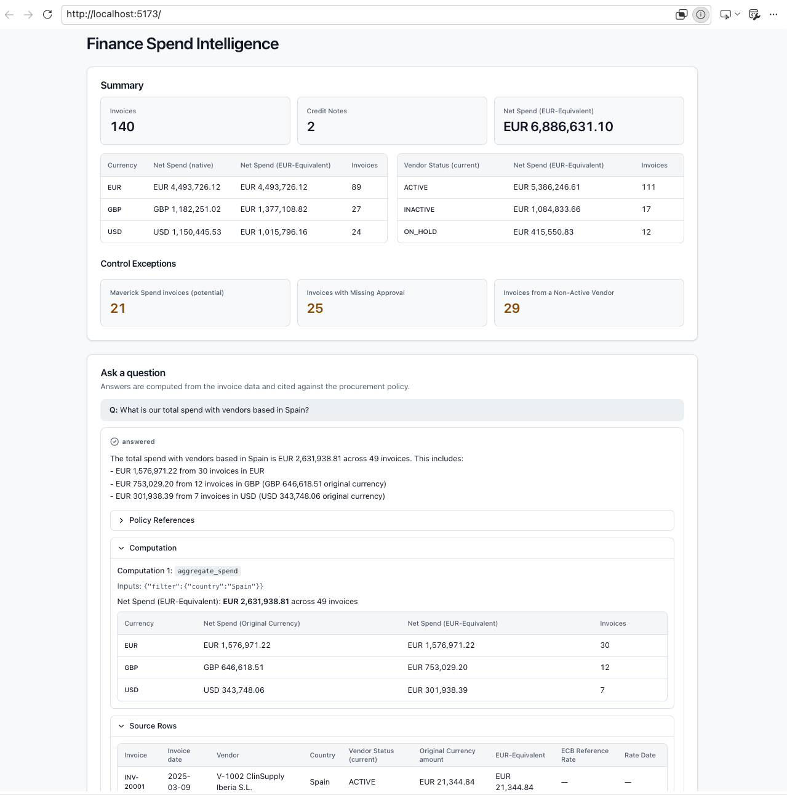

# Finance Spend Intelligence Assistant

A prototype assistant for Finance analysts. It answers questions about the 2025 vendor invoices and the procurement policy (FIN-POL-014) and shows the Evidence behind each answer. The domain vocabulary is defined in [GLOSSARY.md](GLOSSARY.md), and the decisions behind the design are in [docs/adr/](docs/adr/).



## Write-up

**LLM path.** Real calls to AWS Bedrock through the Converse API with native tool calling. The model is set by `BEDROCK_MODEL_ID`.

### What I built, and what I left out

I put correctness and traceability before breadth. The model never does arithmetic. It calls four typed analytics tools (`aggregate_spend`, `list_invoices`, `get_vendors`, `required_approval_tier`, defined in [tools.py](backend/spend_assistant/tools.py)), and Python computes every figure ([ADR 0001](docs/adr/0001-typed-analytics-tools.md)). Each answer shows its Evidence: policy references, Source Rows and the Computation behind it. Citations that can't be verified are dropped and flagged. Questions the data can't answer get a Declined Answer instead of a guess. Currency conversion uses a frozen ECB snapshot ([ADR 0002](docs/adr/0002-frozen-ecb-rate-snapshot.md)). The vocabulary is in [GLOSSARY.md](GLOSSARY.md).

Left out, to stay inside the time box:

- Optional extras.
- Multi-turn conversation. Each question stands alone.
- A code interpreter, deferred in ADR 0001 until lineage from generated code can be captured.
- Auth and Docker.

### How I would evaluate it

1. **Golden set.** Questions with expected figures computed independently with pandas from the raw CSVs and ECB file, compared with the figures in each answer's Computations. The e2e tests do this for a few questions today.
2. **Grounding metrics.** The dropped-citation rate, and whether every number in the answer text appears in a Computation. Both are checkable by code.
3. **Must-decline set.** Out-of-scope questions (other years, unknown vendors, approver-tier and segregation-of-duties checks, prompt-injection attempts) that must return a Declined Answer. The metric is the share correctly declined, plus the share of answerable questions wrongly declined.
4. **LLM-as-judge for faithfulness**, checking that the prose matches the Evidence, plus a sample reviewed by Finance experts to calibrate the judge.

### What production would need

For 200 Finance users on real data:

- SSO, and a gateway that enforces role-based access to tools and injects each user's data scope (for example allowed cost centers) into every call. The tools apply that scope as row-level filters, so access is never decided in the prompt. The gateway also logs every tool call.
- An append-only §8.2 audit record per question (question, tool calls, Evidence, answer, user), kept for 10 years under §8.1.
- ERP (Enterprise Resource Planning) data feeds in place of CSV files.
- Guardrails on model input and output (for example Amazon Bedrock Guardrails) against prompt injection, including through free-text invoice fields. Those fields are already treated as data, but that is untested at scale. The guardrails also block out-of-scope requests and redact sensitive data.
- Cost controls: per-user rate limits and token budgets, caching and model choice.
- Observability: tracing of each agent loop, latency, error rates and the evaluation metrics above on live traffic.


### Time spent and next steps

About 4 hours. Next steps: build the evaluation layers above, add multi-turn, then evaluate a code interpreter for questions the typed tools can't express.

### How AI was used

This repo was written with the GitHub Copilot harness, driven by agent skills. I used `/grill-with-docs` to stress-test the plan against the glossary and ADRs, `/to-spec` to turn the result into a spec and issues, and `/implement` to build each issue test-first and review it. I also designed the `react-shadcn-beautifier` skill, which restyled the frontend with Tailwind and shadcn/ui.

I used [graphify](graphify-out/GRAPH_REPORT.md) to build a knowledge graph of the codebase, so the agent could query it instead of re-reading files to reduce token consumption.

The agentic files (skills and agent instructions) are kept out of this branch, in the [`agents` branch](https://github.com/ulisesrey/az_clincal_genai_assignment/tree/agents).

## Setup

### 1. Data pack

The source data is supplied separately, not committed ([ADR 0003](docs/adr/0003-source-data-supplied-not-committed.md)). Place these three files in `data/` at the repo root:

- `invoices_2025_clean.csv`
- `vendor_master.csv`
- `procurement_policy.md`

To keep them somewhere else, set `DATA_DIR` to that folder. If any file is missing, the backend refuses to start and names the missing files and the path it searched.

The ECB reference-rate snapshot used to calculate EUR-Equivalents is public data and is committed under `backend/spend_assistant/resources/` ([ADR 0002](docs/adr/0002-frozen-ecb-rate-snapshot.md)).

### 2. Backend (Python 3.12+, [uv](https://docs.astral.sh/uv/))

```sh
cd backend
uv sync
uv run python -m spend_assistant      # serves http://localhost:8000 (override with PORT)
```

The chat panel's answers come from AWS Bedrock (Converse API with native tool calling). The backend reads:

- `BEDROCK_MODEL_ID`: the Bedrock model or inference profile (default `eu.anthropic.claude-sonnet-4-5-20250929-v1:0`).
- `AWS_REGION`: the Bedrock region (default `eu-west-1`).
- Credentials from the standard AWS credential chain (environment variables, `AWS_PROFILE`, SSO or `aws login`). The account needs `bedrock:InvokeModel` access to the model.

`POST /ask` returns a Declined Answer (`status: "declined"` with the reason as `answer`) when the question can't be answered from the data and policy. Examples: whether an approver held the required Approval Tier, §7 segregation of duties, years other than 2025, and vendors not in the Vendor Master. It also declines when the model doesn't finish within 5 tool-call iterations, or sends invalid tool arguments again after one correction.

Each Bedrock call times out after 30s, with no retries. A timeout returns a 504 and other Bedrock failures return a 502, both with `{ error, detail }`. Unexpected errors return a 500 that hides internal details.

### 3. Frontend (Node 20+)

```sh
cd frontend
npm install
npm run dev                           # serves http://localhost:5173
```

The frontend calls the backend at `http://localhost:8000` by default. To use a different address, set `VITE_API_URL`. If the frontend runs on another origin, add it to `FRONTEND_ORIGINS` on the backend (comma-separated).

### Makefile shortcuts

From the repo root, `make help` lists all targets. The most common:

```sh
make install      # uv sync + npm install
make dev          # backend + frontend in one terminal; Ctrl-C stops both
make test         # backend pytest
make e2e          # Playwright end-to-end tests
make typecheck    # pyright + tsc
```

## Tests

### Backend

```sh
cd backend
uv run pytest
```

These tests check the analytics tools (`aggregate_spend`, `list_invoices`, `get_vendors`, `required_approval_tier`) on a small synthetic ledger whose figures can be worked out by hand, and the `/ask` agent loop and Evidence assembly against a stubbed Bedrock Converse client. They need neither the data pack nor AWS access.

### End to end

Playwright drives the real frontend against the real backend and the real data pack, with nothing mocked. Playwright starts both servers itself, or reuses ones that are already running.

```sh
cd frontend
npx playwright install chromium       # first time only
npm run e2e
```

The chat tests (`ask-*.spec.ts`) call live AWS Bedrock, so they need the credentials and variables above and use real tokens. They check figures and IDs shown in the Evidence, never the model's wording. Variables exported in the shell (`DATA_DIR`, `AWS_*`, `BEDROCK_MODEL_ID`) reach the backend Playwright starts. If ports 8000 or 5173 are taken, run on others with `E2E_BACKEND_PORT=8123 E2E_FRONTEND_PORT=5199 npm run e2e`.

The expected figures in the tests were computed independently from the raw CSVs and the raw ECB `eurofxref-hist` file. Each invoice's EUR-Equivalent is rounded half-up to the cent, then the results are summed.

Typechecking:

```sh
cd backend && uv run pyright spend_assistant tests
cd frontend && npm run typecheck
```
